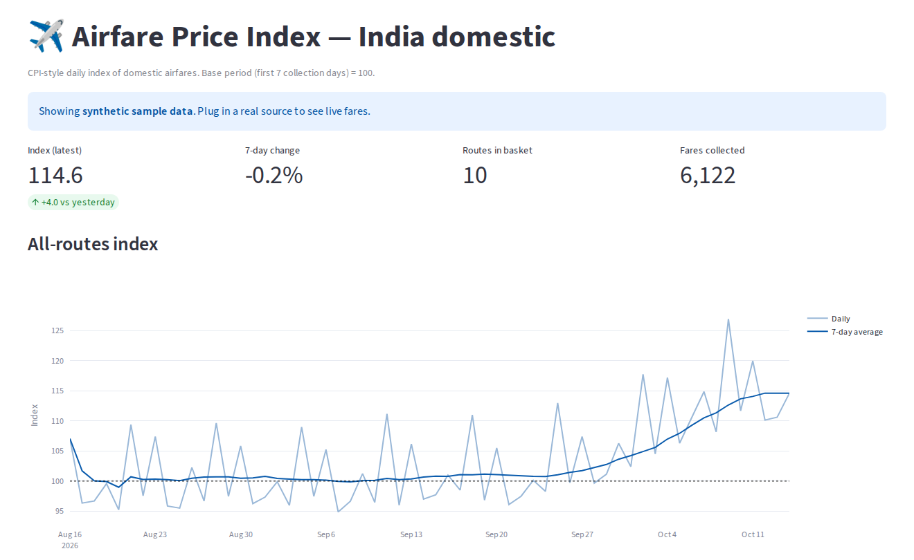

# ✈️ Airfare Price Index — India

A CPI-style **daily price index for Indian domestic airfares**. Fares are collected every day across a fixed basket of routes and booking windows, stored in a normalised SQL database, and combined into one index number (base period = 100) using the methods national statistics offices use.

Inspired by how statistics offices measure inflation: fixed basket, fixed weights, like-for-like comparisons.



> The screenshot uses the built-in **synthetic data source**, so the project runs with no internet or API keys. It models real fare behaviour: last-minute premiums, weekend peaks and the Diwali travel surge that shows up in late October.


---

## Quick start

```bash
git clone https://github.com/<your-username>/airfare-price-index.git
cd airfare-price-index
python -m venv .venv && source .venv/bin/activate   # Windows: .venv\Scripts\activate
pip install -e ".[dashboard,dev]"

airfare collect --days 60 --start 2026-09-15   # backfill 60 days of sample fares
airfare index                                  # print the latest index values
streamlit run dashboard/app.py                 # open the dashboard
pytest                                         # run the tests
```

## Architecture

```
            ┌──────────────┐     ┌───────────────┐     ┌──────────────┐     ┌──────────────┐
 daily ───▶ │ FareSource   │ ──▶ │ collect.py    │ ──▶ │ SQLite       │ ──▶ │ index.py     │ ──▶ Streamlit
 (cron /    │ (sample,     │     │ routes ×      │     │ routes       │     │ Jevons +     │     dashboard
 Actions)   │  playwright) │     │ booking       │     │ sources      │     │ Laspeyres    │     / CSV
            └──────────────┘     │ windows       │     │ fare_obs     │     └──────────────┘
                                 └───────────────┘     └──────────────┘
```

| Layer | File | What it does |
|---|---|---|
| Sources | `src/airfare/sources/` | One class per website. Every source implements `FareSource.fetch()` (Strategy pattern), so a new site never touches the rest of the code. |
| Collection | `src/airfare/collect.py` | For each route × booking window (7/14/30 days ahead), fetches fares. One failing route is logged, not fatal. Re-runs are idempotent. |
| Storage | `src/airfare/schema.sql`, `db.py` | Normalised schema (routes, sources, fare_observations) with a unique key and a composite index on `(collected_on, route_id)`. |
| Index | `src/airfare/index.py` | Computes the index. See the methodology below. |
| Interface | `cli.py`, `dashboard/app.py` | `airfare` CLI and a Streamlit dashboard. |

## Methodology

1. **Elementary price.** For each route, day and booking window, take the **geometric mean** of all carrier fares (Jevons formula). This is robust to one outlier fare and is standard in CPI practice.
2. **Route relative.** Elementary price ÷ the same route's base-period price, averaged over booking windows. Fixing the booking window makes sure the index compares like with like (a 7-day-ahead fare is always compared with a 7-day-ahead fare).
3. **All-routes index.** Weighted arithmetic mean of route relatives using **fixed base-period weights** (Laspeyres-type), × 100.

Weights in `config.py` are placeholders. Replace them with real passenger-spend shares (DGCA traffic × average fare).

## Adding a real data source

**Real fares via the Amadeus Self-Service API** (official, no scraping). Get free keys at [developers.amadeus.com](https://developers.amadeus.com), then:

```bash
export AMADEUS_CLIENT_ID=...  AMADEUS_CLIENT_SECRET=...
airfare collect --source amadeus     # run once a day; live prices only, no backfill
```

It searches **nonstop** flights only so every day compares like with like, and keeps the cheapest fare per airline. The default is Amadeus's *test* environment (free, but cached and limited data); set `AMADEUS_ENV=production` for live fares. Don't mix sources in one database without checking the numbers: the index treats all rows as one series.

**Scraping a website instead?** `sources/playwright_template.py` is a skeleton. Check the site's robots.txt and Terms of Service first, since many airline and travel sites forbid automated access. Rate-limit and collect once a day.

`.github/workflows/daily-collect.yml` runs the collection every morning at 07:00 IST on GitHub Actions and commits the new data. It uses the sample source; to switch, change `--source sample` to `--source amadeus` and add the two keys as repository secrets (passed as `env:` in the step).

## Deploy the dashboard (free)

Push to GitHub → [share.streamlit.io](https://share.streamlit.io) → *New app* → pick this repo, main file `dashboard/app.py`. `requirements.txt` is already set up. Put the live link at the top of this README.

## Tests

```bash
pytest -q        # 19 tests: validation, index maths, pipeline, CLI, Amadeus parsing
ruff check .     # lint
```

The index tests check the maths against hand-computed values: base period = 100, a uniform 10% rise gives 110, and weights are applied correctly.

## Roadmap

- [ ] Real source (API or permitted scraper)
- [ ] PostgreSQL + Docker Compose
- [ ] Hedonic adjustment for carrier/stops, and chain-linking when the basket changes
- [ ] Anomaly alerts when the index moves more than X% in a day
- [ ] Compare against the official CPI transport sub-index

## License

MIT
